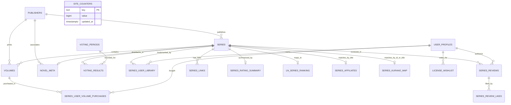

# LiDex Platform — Project Architecture & Database Mapping Guide

This document is the authoritative, comprehensive guide to the **LiDex** codebase architecture, database schemas, page mechanics, API endpoints, data pipelines, external integrations (Kurano, Shopee/TikTok Affiliates), and data table relationships. It is specifically written so that any **AI Coding Assistant** or human developer can immediately understand how the entire system functions, how data flows between tables and UI components, and how to safely make modifications without introducing regressions.

---

## 1. Executive Summary & Tech Stack

**LiDex** (`wibubros.id.vn`) is a web analytics, interactive discovery, and community platform for Light Novels in Vietnam. It provides:
1. **Interactive Light Novel Discovery & Gacha Unboxing** (`/` - Homepage): CS:GO/FGO-style unboxing simulation with dynamic rarity tiers (Báu vật, Huyền thoại, Sơ cấp, Hiếm, Thông thường) calculated via composite market and community voting scores. Features real-time roll odds (1% SSR drop rate), deterministic roll percentage stats, active Shopee/TikTok affiliate links, and direct Kurano release details.
2. **Interactive 20-Box Light Novel Collage Generator** (`/collage` - "Danh sách của tôi"): 9koma-inspired customizable 20-box reading category board. Restricts selection strictly to the LiDex Light Novel database catalog with volume-level cover selection, locked watermark (`LiDex • wibubros.id.vn`), mobile sticky controls, image preview modal, and 100% client-side high-res PNG export (zero Cloudflare server/worker bandwidth).
3. **Canonical Series Profile** (`/content/[id]`): Full series profile with volume schedule grid, price trends, Shopee/TikTok purchase links, Kurano release info, user ratings, radar charts, and community reviews.
4. **Market Watchlist & Analytics Dashboard** (`/dashboard`): Dead-or-Alive (DOA) matrix, publisher output statistics, release cadence, drop probabilities, and market health metrics.
5. **User Profiles & Collection Management** (`/user`): User profile settings, reading lists, collection tracking, and avatar uploads.
6. **Public User Bookshelves** (`/bookshelf/[userId]`): Public user collection showcase with collection valuation vs MSRP, series completion %, and volume grid.
7. **Archived Modules** (`/_archive`): Experimental analytics, graphs, and legacy matrices preserved in `/_archive` for future reference and remaking.

### Technology Stack
* **Framework**: Next.js 14 (App Router, React Server Components & Client Components).
* **Language**: TypeScript (`.ts`, `.tsx`), Node.js (v22.14 LTS), Python 3 (local pipeline & tooling).
* **Styling**: TailwindCSS, CSS Variables design tokens (`src/app/globals.css`), Glassmorphism dark mode UI.
* **Database**: **Neon PostgreSQL** (Serverless connection pooler via `@neondatabase/serverless`).
* **Deployment & Edge Runtime**: Cloudflare Pages (`opennextjs-cloudflare` / `@cloudflare/next-on-pages` adapter) and Cloudflare CDN Edge Caching.
* **Authentication**: **Supabase Auth** (Client-side JWT session tokens passed via `Authorization: Bearer <token>` to API routes).
* **Media & Image Storage**: **Cloudflare R2** bucket (`lidex-covers`, public domain `https://pub-2080c0fa70954a7e98e48daff887c4cf.r2.dev/covers/...`) + Self-hosted fallback proxy (`/api/image-proxy`).
* **Client Caching**: PWA Service Worker (`public/sw.js`) with Cache-First image caching (7-day TTL), HTTP 304 ETag support, and `sessionStorage` catalog caching.

---

## 2. Master Entity-Relationship (ER) Schema



---

## 3. Database Tables Reference & Field Dictionary

### 3.1. `series` (Core Media Entity)
The foundational table for all licensed Vietnamese Light Novel series.
* `id` (`integer`, Primary Key, Sequence): Canonical integer ID used across internal routes (`/content/[id]`).
* `item_type` (`text`, NOT NULL): Standardized to `'novel'` (manga records purged in standard pipeline).
* `title` (`text`, NOT NULL): Canonical title in Vietnamese/English.
* `title_vi` (`text`): Official Vietnamese localization title.
* `title_native` (`text`): Original Japanese kanji/kana.
* `title_english` (`text`): Official English title.
* `slug` (`text`): URL slug.
* `cover_url` (`text`): Primary canonical cover image URL (Cloudflare R2: `https://pub-2080c0fa70954a7e98e48daff887c4cf.r2.dev/covers/<uuid>.jpg`).
* `banner_url` (`text`): Wide horizontal banner image URL.
* `description` (`text`), `description_vi` (`text`): Synopsis in English/Vietnamese.
* `status` (`text`): Publication status (`'ongoing'`, `'completed'`, `'hiatus'`, `'cancelled'`, `'releasing'`).
* `genres` (`text[]`): PostgreSQL array of genres (e.g. `ARRAY['Fantasy', 'Romance', 'Comedy']`).
* `publisher_id` (`integer`, Foreign Key -> `publishers.id`): Primary Vietnamese publisher.
* `author` (`text`), `artist` (`text`): Creators.

### 3.2. `volumes` (Vietnamese Physical Releases)
Individual published volumes in Vietnam (970+ volumes cataloged).
* `id` (`integer`, Primary Key, Sequence).
* `series_id` (`integer`, Foreign Key -> `series.id`, NOT NULL).
* `publisher_id` (`integer`, Foreign Key -> `publishers.id`): Publisher for this volume.
* `volume_number` (`integer`, NOT NULL): Sequence number (1, 2, 3...). For special side-story volumes without integer numbers, assigned `100 + sort_order` with `is_special = true`.
* `title` (`text`): Volume subtitle or standard name (e.g. `Tập 1`, `Tập 2`).
* `isbn` (`text`): ISBN-10 or ISBN-13 barcode.
* `cover_url` (`text`): Direct Cloudflare R2 URL (`https://pub-2080c0fa70954a7e98e48daff887c4cf.r2.dev/covers/<uuid>.jpg`).
* `release_date` (`date`): Official release date in Vietnam.
* `price` (`numeric`): MSRP price in Vietnamese Đồng (e.g., `110000.00`).
* `currency` (`text`): `'VND'`.
* `is_special` (`boolean`): Whether this is an omnibus, special edition, side-story, or artbook.
* `page_count` (`integer`), `translator` (`text`).

### 3.3. `publishers` (Vietnamese Publishing Houses)
* `id` (`integer`, Primary Key, Sequence).
* `name` (`text`, NOT NULL): Short name (e.g., `'Kim Đồng'`, `'IPM'`, `'Thái Hà Books'`, `'Nhã Nam'`, `'Tsuki Light Novel'`, `'Wings Books'`).
* `name_vi` (`text`): Full formal Vietnamese legal entity name.
* `logo_url` (`text`): Publisher emblem image URL.
* `website` (`text`), `country` (`text`).

### 3.4. `ln_series_ranking` (Light Novel Market Intelligence & Watchlist)
Contains evaluation scores, release frequencies, and publication drop probabilities.
* `id` (`bigint`, Primary Key, Sequence): Ranking row ID.
* `series_title` (`text`, NOT NULL): Light Novel title.
* `series_id` (`text`): Legacy string ID from Hako/Docln source.
* `lidex_series_id` (`bigint`, Foreign Key -> `series.id`): **Canonical foreign key linking this ranking row to `series.id` (100% mapped, 0 NULLs)**.
* `series_code` (`text`): Short identifier code (e.g. `'oregairu'`, `'86'`).
* `publisher` (`text`): Publisher name string (e.g., `'Thái Hà Books'`).
* `number_of_volumes` (`numeric`): Total released Vietnamese volumes.
* `average_price` (`numeric`): Average volume MSRP.
* `max_release_at` (`timestamp without time zone`): Date of the latest volume release.
* `ln_score` (`numeric`): Algorithmic Light Novel score (0.0 to 10.0 scale).
* `evalution` (`text`): Verdict category (`'Good'`, `'Normal'`, `'Dead'`, `'Hiatus'`, etc.).
* `drop_percent` (`numeric`): Risk probability that the series is stalled/dropped (0.0 to 1.0).
* `drop_basis` (`text`), `evaluation_basis` (`text`): Explanations for calculations.
* `average_gap_months` (`numeric`): Mean gap between volume releases.
* `months_since_last_release` (`numeric`): Months elapsed since `max_release_at`.
* `completion_ratio` (`numeric`): Ratio of VN volumes vs original JP volumes.
* `publisher_releases_last_24m` (`numeric`): Total releases by this publisher in the last 24 months.

### 3.5. `voting_periods` & `voting_results` (Community Polls)
* **`voting_periods`**: `id` (`integer` PK), `year`, `month`, `label` (e.g. `'12/2019'`, `'06/2023'`).
* **`voting_results`**: `id` (`integer` PK), `series_id` (`integer` FK -> `series.id`), `period_id` (`integer` FK -> `voting_periods.id`), `votes` (`integer`), `rank` (`integer`).

### 3.6. `site_counters` (Global Site Metrics)
* `key` (`text`, Primary Key): Metric name (`'what_to_read_rolls'`).
* `value` (`bigint`, Default 0): Atomic roll counter.
* `updated_at` (`timestamptz`).

### 3.7. User Collection & Social Tables
* `user_profiles`: `user_id` (`uuid` PK), `display_name`, `avatar_url`, `is_premium`, `premium_tier`, `premium_until`.
* `series_user_library`: `id` (`bigint` PK), `user_id` (`uuid`), `series_id` (`bigint` FK -> `series.id`), `rating`, `status` (`'reading'`, `'completed'`, `'dropped'`, `'planned'`).
* `series_user_volume_purchases`: `user_id` (`uuid`), `volume_id` (`integer` FK -> `volumes.id`), `created_at`.
* `series_reviews`: `id` (`integer` PK), `series_id` (`integer` FK -> `series.id`), `user_id` (`uuid`), `content`, `created_at`.
* `series_review_likes`: `review_id` (`integer` FK -> `series_reviews.id`), `user_id` (`uuid`).
* `license_wishlist`: `id` (`integer` PK), `user_id` (`text`), `series_title` (`text`), `created_at`.

---

## 4. Static Datasets & External Integrations

### 4.1. Active Affiliate Links (`src/data/series_affiliates.json`)
* **Source**: `C:\Users\ADMIN\Desktop\Web\Organized\Kurano_Affiliate_Parsed.xlsx` (Sheet: `Affiliate Links`).
* **Specification**:
  * Strictly includes active links with modern domains (`s.shopee.vn`, `vt.tiktok.com`).
  * Legacy links (`shope.ee`) are excluded.
  * For series with multiple volume links, selects the **latest published volume**.
  * **Shopee is prioritized** over TikTok.
* **Schema**:
  ```typescript
  interface AffiliateRecord {
    url: string          // Direct Shopee/TikTok URL
    platform: string     // "Shopee" | "TikTok"
    volume: number       // Latest volume number (e.g. 14 for 86, 10 for Arya)
    volumeTitle?: string // Full volume product title
    type: string         // "active"
  }
  ```
* **Matching**: Normalized fuzzy title matching via `getSeriesAffiliate(title)` (handles diacritics, symbols, brackets, and common aliases like *Arya* / *Alya*).

### 4.2. Kurano Release Mapping (`src/data/series_kurano_map.json`)
* **Source**: `C:\Users\ADMIN\Desktop\Web\Organized\Kurano_Title_BookID.txt` (GraphQL export containing 243 titles and 973 book nodes).
* **Specification**:
  * Connects LiDex series to their canonical page on Kurano Moe: `https://kurano.moe/tap-truyen/{bookId}/{slug}`.
  * Resolves 238+ series (97% catalog coverage) by matching volume cover UUIDs from `volumes.cover_url` directly against Kurano book IDs, with title/slug fallbacks.
  * Explicit mapping: Series 223 (*Ác Nữ Nửa Vời - Truyền Kì Hoán Hồn Đổi Xác*) $\to$ `https://kurano.moe/tap-truyen/5ecf395c-12b6-40fb-8f3b-d378f90ca1b1/ac-nu-nua-voi-truyen-ki-hoan-hon-doi-xac`.
* **Schema**:
  ```typescript
  interface KuranoRecord {
    url: string   // Canonical Kurano URL
    slug: string  // Vietnamese slug
    title: string // Full title
  }
  ```

---

## 5. Active Core Routes & Mechanics

| Page Route | Component Location | Primary Data Sources | Functionality & Mechanics |
| :--- | :--- | :--- | :--- |
| **`/` (Root)** | [`src/app/page.tsx`](file:///src/app/page.tsx) | `ln_series_ranking`, `series`, `site_counters`, `series_affiliates.json`, `series_kurano_map.json` | **Light Novel Discovery & Gacha Unboxing Game**: CS:GO-style reel animation with CS:GO audio sound effects. FGO-style SSR drop rates (Tier 4: 1%, Tier 3: 4%, Tier 2: 15%, Tier 1: 30%, Tier 0: 50%). Holographic golden yellow glow for Tier 4. Stat: *"Đã có X% người dùng quay ra truyện này"*. Buttons: `[Mua ngay]` (Shopee/TikTok), `[Chi tiết]` (opens Kurano release page in new tab), `[Reroll]` (spin again). Cover and title link to `/content/[id]`. |
| **`/collage` (Danh sách của tôi)** | [`src/app/collage/page.tsx`](file:///src/app/collage/page.tsx) | `ln_series_ranking`, `series`, `volumes` | **20-Box Light Novel Collage Generator**: 9koma-style interactive grid. Allows selecting series and individual volume covers strictly from the LiDex database. Locked watermark `LiDex • wibubros.id.vn`. Image preview modal, mobile sticky controls, and client-side high-res PNG export with zero Cloudflare worker bandwidth. |
| **`/content/[id]` (Chi tiết tác phẩm)** | [`src/app/content/[id]/page.tsx`](file:///src/app/content/[id]/page.tsx) | `series`, `volumes`, `publishers`, `series_reviews`, `series_links`, `series_affiliates.json`, `series_kurano_map.json` | **Canonical Series Profile**: Streamlined volume schedule viewer with `<` / `>` volume pagination. External links section prominently displays `Shopee` (clean label, no badge) and `Kurano (Thông tin phát hành)`. User reviews, reading status tracker, and LiDex radar score. |
| **`/dashboard` (Bảng theo dõi)** | [`src/app/dashboard/page.tsx`](file:///src/app/dashboard/page.tsx) | `ln_series_ranking`, `series`, `publishers` | **Market Watchlist & DOA Matrix**: Publisher market share, volume release frequency, and drop risk indicators. |
| **`/user` (Cá nhân)** | [`src/app/user/page.tsx`](file:///src/app/user/page.tsx) | `user_profiles`, `series_user_library` | User profile settings, reading lists, collection tracking, and avatar uploads (`/api/upload-avatar`). |
| **`/bookshelf/[userId]` (Tủ sách cá nhân)** | [`src/app/bookshelf/[userId]/page.tsx`](file:///src/app/bookshelf/[userId]/page.tsx) | `user_profiles`, `series_user_volume_purchases`, `volumes`, `series` | Public user collection showcase. Calculates collection valuation vs total MSRP, series completion %, and volume grid. |

---

## 6. Performance, Caching & Cloudflare Free-Tier Optimizations

To ensure zero billing surprises and prevent exceeding Cloudflare's free tier limits (100,000 Worker requests/day), the platform employs a multi-tiered caching architecture:

### 1. Service Worker Cache-First Image Engine (`public/sw.js`)
* Intercepts all image requests (`/api/image-proxy`, `r2.dev`, `.jpg`, `.png`, `.webp`, `.svg`).
* Serves cached images immediately from CacheStorage (`lidex-images-v1`) without making any network requests.
* TTL is set to **7 days** (`max-age=604800, s-maxage=604800, stale-while-revalidate=86400`), perfectly matching the weekly publisher release and content update schedule.
* Automatic LRU cache trimming maintains a maximum of 800 items to protect device memory.

### 2. Direct Cloudflare R2 Delivery
* Volume and series covers use `https://pub-2080c0fa70954a7e98e48daff887c4cf.r2.dev/covers/<uuid>.jpg`.
* In `src/lib/imageProxy.ts`, `isDirectCdn()` detects R2 and Supabase URLs, completely bypassing the `/api/image-proxy` worker route.

### 3. Client-Side Catalog Caching
* The `/collage` page caches the Light Novel catalog in `sessionStorage` (`lidex_collage_catalog_cache_v2`), eliminating repeated API calls when users navigate between tabs or re-open pickers.

### 4. Client-Side Canvas Rendering
* Generating and downloading 20-box collage images is performed 100% in the user's browser using HTML5 Canvas (`ctx.drawImage`), eliminating server-side rendering loads.

---

## 7. Crucial Data Linking Rules & SQL Patterns

### Rule 1: Safe Linking of `ln_series_ranking` to `series`
`ln_series_ranking.series_id` is legacy `TEXT` while `series.id` is `INTEGER`. Direct comparison throws `operator does not exist: integer = text`.
Always join on `ln_series_ranking.lidex_series_id = series.id`:
```sql
SELECT DISTINCT ON (r.id)
  r.*,
  s.cover_url as series_cover,
  s.id as resolved_series_id
FROM ln_series_ranking r
LEFT JOIN series s ON s.id = r.lidex_series_id
ORDER BY r.id, r.ln_score DESC;
```

### Rule 2: Client-side Image Error Isolation in React
When rendering items inside dynamic CSS animations (such as the unboxing reel), browsers cancel HTTP image requests for DOM nodes far off-screen (`ERR_CANCELLED`), triggering ``.
* Never use raw IDs for error keys. Always scope by UI context:
  * Reel cards: `markImgError('reel-' + id)`
  * Inventory cards: `markImgError('inv-' + n.id)`
  * Unbox result modal: `markImgError('result-' + result.id)`

---

## 8. Development & Deployment Guidelines

### 8.1. Running Local Builds
To avoid Node TLS certificate verification issues on Windows development machines:
```powershell
$env:NODE_TLS_REJECT_UNAUTHORIZED="0"; npm.cmd run build
```

### 8.2. Committing & Pushing to GitHub
* **Strict Remote Target**: Push strictly to `origin` (`https://github.com/jayroring2013/lidex_cf.git`) on branch `main`.
* **Forbidden**: Never push to `lidex_vercel` or any other git remote.
```powershell
git add <files>
git commit -m "feat/fix: descriptive message"
git push origin main
```
*Cloudflare Pages automatically triggers an Edge build upon pushing to `main`.*
