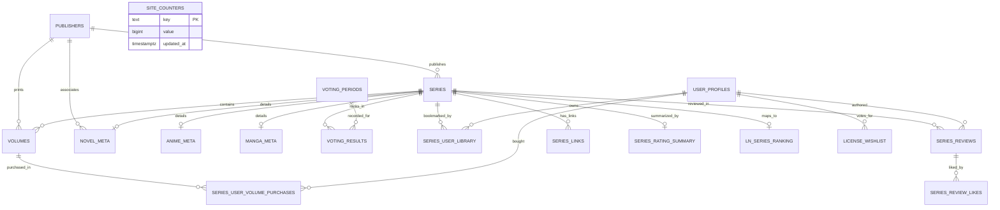

# LiDex Platform — Project Architecture & Database Mapping Guide

This document is the authoritative, comprehensive guide to the **LiDex** codebase architecture, database schemas, page mechanics, API endpoints, and data table relationships. It is specifically written so that any **AI Coding Assistant** or human developer can immediately understand how the entire system functions, how data flows between tables and UI components, and how to safely make modifications without introducing regressions.

---

## 1. Executive Summary & Tech Stack

**LiDex** (`wibubros.id.vn`) is a web analytics and community platform for Light Novels, Manga, and Anime in Vietnam. It provides:
1. **Catalog Discovery & Faceted Search** (`/browse`): Multi-filter catalog across Light Novels, Manga, and Anime with genre, publisher, demographic, and status filters.
2. **Interactive Light Novel Discovery & Case Opening** (`/what-to-read`): CS:GO-style unboxing simulation with dynamic rarity tiers (Báu vật, Huyền thoại, Sơ cấp, Hiếm, Thông thường) calculated via composite market and community voting scores.
3. **Canonical Series Profile** (`/content/[id]`): Full series profile with volume schedule grid, retail purchase links, DOA status, user ratings, radar charts, and community reviews.
4. **User Profiles & Personal Management** (`/user`): User profile settings, reading lists, collection tracking, and avatar uploads.
5. **Public User Bookshelves** (`/bookshelf/[userId]`): Public user collection showcase with collection valuation vs MSRP, series completion %, and volume grid.
6. **Archived Modules** (`/_archive`): Experimental analytics, graphs, and matrices (DOA dashboard, treemaps, novel network visualizer, licensing prediction, etc.) preserved in `/_archive` for future reference and remaking.

### Technology Stack
* **Framework**: Next.js 14 (App Router, React Server Components & Client Components).
* **Language**: TypeScript (`.ts`, `.tsx`), Node.js, Python 3 (local tooling & sync).
* **Styling**: TailwindCSS, CSS Variables design tokens (`src/app/globals.css`), Glassmorphism dark mode UI.
* **Database**: **Neon PostgreSQL** (Serverless connection pooler via `@neondatabase/serverless` / `psycopg2`).
* **Deployment & Edge Runtime**: Cloudflare Pages (`@cloudflare/next-on-pages` adapter) and Cloudflare CDN Edge Caching.
* **Authentication**: **Supabase Auth** (Client-side JWT session tokens passed via `Authorization: Bearer <token>` to API routes).
* **Media & Image Storage**: **Cloudflare R2** bucket (`https://pub-2080c0fa70954a7e98e48daff887c4cf.r2.dev/covers/...`) + Self-hosted fallback proxy (`/api/image-proxy`).

---

## 2. Master Entity-Relationship (ER) Schema



---

## 3. Database Tables Reference & Field Dictionary

### 3.1. `series` (Core Media Entity)
The foundational table for all titles (Light Novels, Manga, Anime).
* `id` (`integer`, Primary Key, Sequence): Canonical integer ID used across all internal routes (`/content/[id]`).
* `item_type` (`text`, NOT NULL): Restricted to `'novel'`, `'manga'`, or `'anime'`.
* `title` (`text`, NOT NULL): Canonical title (usually Vietnamese or English).
* `title_vi` (`text`): Official Vietnamese localization title.
* `title_native` (`text`): Original Japanese kanji/kana.
* `title_english` (`text`): Official English title.
* `slug` (`text`): URL slug.
* `cover_url` (`text`): Primary canonical cover image URL (prioritizes Cloudflare R2: `https://pub-*.r2.dev/covers/...`).
* `banner_url` (`text`): Wide horizontal banner image URL.
* `description` (`text`), `description_vi` (`text`): Synopsis in English/Vietnamese.
* `status` (`text`): Publication status (`'releasing'`, `'completed'`, `'hiatus'`, `'cancelled'`).
* `genres` (`text[]`): PostgreSQL array of genres (e.g. `ARRAY['Romance', 'Comedy', 'School']`).
* `publisher_id` (`integer`, Foreign Key -> `publishers.id`): Primary Vietnamese publisher.
* `author` (`text`), `artist` (`text`): Creators.

### 3.2. `volumes` (Vietnamese Physical Releases)
Individual published volumes in Vietnam.
* `id` (`integer`, Primary Key, Sequence).
* `series_id` (`integer`, Foreign Key -> `series.id`, NOT NULL).
* `publisher_id` (`integer`, Foreign Key -> `publishers.id`): Specific publisher for this volume.
* `volume_number` (`integer`, NOT NULL): Sequence number (1, 2, 3...).
* `title` (`text`): Volume subtitle or standard name (e.g., `Tập 1`).
* `isbn` (`text`): ISBN-10 or ISBN-13 barcode.
* `cover_url` (`text`): Volume cover art (Cloudflare R2 URL or external proxy).
* `release_date` (`date`): Official release date in Vietnam.
* `price` (`numeric`): MSRP price in Vietnamese Đồng (e.g., `110000`).
* `is_special` (`boolean`): Whether this is an omnibus, special edition, or artbook.
* `page_count` (`integer`), `translator` (`text`).

### 3.3. `publishers` (Vietnamese Publishing Houses)
* `id` (`integer`, Primary Key, Sequence).
* `name` (`text`, NOT NULL): Short name (e.g., `'Kim Đồng'`, `'IPM'`, `'Thái Hà Books'`, `'Nhã Nam'`, `'Tsuki Light Novel'`).
* `name_vi` (`text`): Full formal Vietnamese legal entity name.
* `logo_url` (`text`): Publisher emblem image URL.
* `website` (`text`), `country` (`text`).

### 3.4. `ln_series_ranking` (Light Novel Market Intelligence & Watchlist)
Contains evaluation scores, release frequencies, and publication drop probabilities.
* `id` (`bigint`, Primary Key, Sequence): Ranking row ID.
* `series_title` (`text`, NOT NULL): Light Novel title.
* `series_id` (`text`): **Legacy string ID from Hako/Docln source** (e.g. `'45'`, `'147'`, `'6002'`). **CAUTION**: Contains text strings; cannot be directly compared to integers without regex casting.
* `lidex_series_id` (`bigint`, Foreign Key -> `series.id`, Nullable): **Canonical foreign key linking this ranking row to `series.id`**.
* `series_code` (`text`): Short identifier code (e.g. `'oregairu'`, `'86'`).
* `publisher` (`text`): Publisher name string (e.g., `'Thái Hà Books'`).
* `number_of_volumes` (`numeric`): Total released Vietnamese volumes.
* `average_price` (`numeric`): Average volume MSRP.
* `max_release_at` (`timestamp without time zone`): Date of the latest volume release.
* `ln_score` (`numeric`): Algorithmic Light Novel score (0.0 to 10.0 scale).
* `evalution` (`text`): Verdict category (`'Good'`, `'Normal'`, `'Dead'`, `'Hiatus'`, etc.).
* `drop_percent` (`numeric`): Risk probability that the series is stalled/dropped (0% to 100%).
* `drop_basis` (`text`), `evaluation_basis` (`text`): Explanation strings for calculations.
* `average_gap_months` (`numeric`): Mean gap between volume releases.
* `months_since_last_release` (`numeric`): Months elapsed since `max_release_at`.
* `completion_ratio` (`numeric`): Ratio of VN volumes vs original JP volumes.
* `publisher_releases_last_24m` (`numeric`): Total releases by this publisher in the last 24 months.
* `score_components` (`text`), `drop_components` (`text`): JSON string breakdowns.

### 3.5. `voting_periods` & `voting_results` (Community Polls)
* **`voting_periods`**:
  * `id` (`integer`, Primary Key).
  * `year` (`integer`), `month` (`integer`).
  * `label` (`text`): Period name (e.g. `'12/2019'`, `'06/2023'`).
* **`voting_results`**:
  * `id` (`integer`, Primary Key).
  * `series_id` (`integer`, Foreign Key -> `series.id`).
  * `period_id` (`integer`, Foreign Key -> `voting_periods.id`).
  * `votes` (`integer`): Vote count in that poll.
  * `rank` (`integer`): Final placement (1, 2, 3...).

### 3.6. `site_counters` (Global Site Metrics)
* `key` (`text`, Primary Key): Metric name (e.g., `'what_to_read_rolls'`).
* `value` (`bigint`, Default 0): Atomic roll counter.
* `updated_at` (`timestamptz`).

### 3.7. User Collection & Social Tables
* `user_profiles`: `user_id` (`uuid` PK), `display_name`, `avatar_url`, `is_premium`, `premium_tier`, `premium_until`.
* `series_user_library`: `id` (`bigint` PK), `user_id` (`uuid`), `series_id` (`bigint` FK -> `series.id`), `rating`, `status` (`'reading'`, `'completed'`, `'dropped'`).
* `series_user_volume_purchases`: `user_id` (`uuid`), `volume_id` (`integer` FK -> `volumes.id`), `created_at`.
* `series_reviews`: `id` (`integer` PK), `series_id` (`integer` FK -> `series.id`), `user_id` (`uuid`), `content`, `created_at`.
* `series_review_likes`: `review_id` (`integer` FK -> `series_reviews.id`), `user_id` (`uuid`).
* `license_wishlist`: `id` (`integer` PK), `user_id` (`text`), `series_title` (`text`), `created_at`.

---

## 4. Crucial Data Linking Rules & SQL Patterns

### Rule 1: Safe Linking of `ln_series_ranking` to `series`
Because `ln_series_ranking.series_id` is `TEXT` while `series.id` is `INTEGER`, a raw `s.id = r.series_id` throws:
`psycopg2.errors.UndefinedFunction: operator does not exist: integer = text`.
Furthermore, `r.series_id` contains legacy source IDs that often collide with completely different `series.id` rows (e.g., Oregairu had source ID `'45'`, while `series.id = 45` is Cop Craft!).

**The Canonical JOIN Pattern** (defined in [`fetchDashboardWatchlistData()`](file:///c:/Users/ADMIN/Desktop/Web/Current%20web/New%20folder/New%20folder/src/lib/db.ts)):
```sql
SELECT DISTINCT ON (r.id)
  r.*,
  s.cover_url as series_cover,
  COALESCE(s.id, r.lidex_series_id, CASE WHEN r.series_id ~ '^[0-9]+$' THEN r.series_id::int ELSE NULL END) as resolved_series_id
FROM ln_series_ranking r
LEFT JOIN series s ON (
  s.id = r.lidex_series_id 
  OR (r.lidex_series_id IS NULL AND (
    (r.series_id ~ '^[0-9]+$' AND s.id = r.series_id::int)
    OR LOWER(TRIM(s.title)) = LOWER(TRIM(r.series_title))
    OR LOWER(TRIM(s.title_vi)) = LOWER(TRIM(r.series_title))
    OR (r.series_title IS NOT NULL AND (s.title ILIKE '%' || TRIM(r.series_title) || '%' OR r.series_title ILIKE '%' || TRIM(s.title_vi) || '%'))
  ))
)
ORDER BY r.id, 
  (CASE WHEN s.id = r.lidex_series_id THEN 0 ELSE 1 END),
  (CASE WHEN s.item_type = 'novel' THEN 0 ELSE 1 END),
  (CASE WHEN s.cover_url LIKE '%r2.dev%' OR s.cover_url LIKE '%imagedelivery.net%' THEN 0 ELSE 1 END),
  (CASE WHEN s.cover_url IS NOT NULL THEN 0 ELSE 1 END),
  r.ln_score DESC;
```

### Rule 2: Cover Image Resolution Hierarchy
Cover images must always resolve to clean, high-availability CDN assets:
1. **Cloudflare R2 / Direct CDN**: `https://pub-2080c0fa70954a7e98e48daff887c4cf.r2.dev/covers/...`, Supabase, or Tana.
2. **Volume 1 Cover Fallback**: `SELECT v.cover_url FROM volumes v WHERE v.series_id = s.id ... ORDER BY v.volume_number ASC LIMIT 1`.
3. **External Retailer Proxy**: Images on Fahasa (`cdn1.fahasa.com`), Hstatic, or Docln cannot be hotlinked directly due to CORS/Referer hotlink protection. They are piped through `proxyImg()` / `/api/image-proxy?url=...` with automatic spoofed referers.
4. **Domain Sanitization**: Defunct `.hako.re` URLs are automatically rewritten to `.hako.vn`.

### Rule 3: Client-side Image Error Isolation in React
When rendering items inside dynamic animations (like the CS:GO reel on `/what-to-read`), modern web browsers cancel HTTP image requests for DOM nodes positioned far off-screen (`ERR_CANCELLED`), which fires the `` callback.
* **Never** use naked IDs (`imgErrorMap[novel.id]`) for error tracking.
* **Always** prefix error keys by their UI scope:
  * Reel cards: `markImgError('reel-' + id)`
  * Inventory grid cards: `markImgError('inv-' + n.id)`
  * Unbox result modal: `markImgError('result-' + result.id)`

---

### 5.1. Active Core Routes
| Page Route | Client Component / Location | Primary Data Tables | Functionality & Mechanics |
| :--- | :--- | :--- | :--- |
| **`/` (Root)** | [`src/app/page.tsx`](file:///c:/Users/ADMIN/Desktop/Web/Current%20web/New%20folder/New%20folder/src/app/page.tsx) | N/A | Clean permanent redirect to `/browse`. |
| **`/browse` (Khám phá)** | [`src/app/browse/page.tsx`](file:///c:/Users/ADMIN/Desktop/Web/Current%20web/New%20folder/New%20folder/src/app/browse/page.tsx) | `series`, `manga_meta`, `novel_meta`, `anime_meta`, `publishers` | Multi-filter faceted search across Light Novels, Manga, and Anime with genre, publisher, demographic, and status filters. |
| **`/what-to-read` (Hôm nay đọc gì?)** | [`src/app/what-to-read/page.tsx`](file:///c:/Users/ADMIN/Desktop/Web/Current%20web/New%20folder/New%20folder/src/app/what-to-read/page.tsx) | `ln_series_ranking`, `series`, `voting_results`, `site_counters` | **CS:GO-style Light Novel Unboxing Game**: Filters out 0-volume titles. Calculates composite score: `(LN_Score * 0.55) + (Vote_Popularity * 0.45)`. Strict rarity tiers: Báu vật 👑, Huyền thoại 🔴, Sơ cấp 🟣, Hiếm 💜, Thông thường 💙. Audio engine, spinning reel physics, StatTrak counter via `/api/rolls`. |
| **`/content/[id]` (Chi tiết tác phẩm)** | [`src/app/content/[id]/page.tsx`](file:///c:/Users/ADMIN/Desktop/Web/Current%20web/New%20folder/New%20folder/src/app/content/%5Bid%5D/page.tsx) | `series`, `volumes`, `publishers`, `series_reviews`, `series_rating_summary` | Full series profile with volume schedule grid, retail purchase links, DOA status, user ratings, radar charts, and community reviews. |
| **`/user` (Cá nhân)** | [`src/app/user/page.tsx`](file:///c:/Users/ADMIN/Desktop/Web/Current%20web/New%20folder/New%20folder/src/app/user/page.tsx) | `user_profiles`, `series_user_library` | User profile management, reading lists, collection tracking, and avatar upload (`/api/upload-avatar`). |
| **`/bookshelf/[userId]` (Tủ sách cá nhân)** | [`src/app/bookshelf/[userId]/page.tsx`](file:///c:/Users/ADMIN/Desktop/Web/Current%20web/New%20folder/New%20folder/src/app/bookshelf/%5BuserId%5D/page.tsx) | `user_profiles`, `series_user_volume_purchases`, `series_user_library`, `volumes`, `series` | Public user collection showcase. Calculates collection valuation vs total MSRP, series completion %, and volume grid. |

### 5.2. Archived Modules (`/_archive/`)
The following pages and components have been moved to `_archive/` (excluded from TypeScript compilation and Next.js route builds) so that they can be referenced or remade in the future:
* **`_archive/pages/dashboard`**: Dead-or-Alive (DOA) matrix analyzing Light Novel health in Vietnam.
* **`_archive/pages/publisher`**: Market share treemap and Vietnamese publisher statistics.
* **`_archive/pages/novel-network`**: Interactive 2D canvas force-directed graph.
* **`_archive/pages/license-prediction`**: Top 1000 unlicensed Light Novel wishlist voting.
* **`_archive/pages/leaderboard`**: Historical community voting poll leaderboard.
* **`_archive/pages/charts`**: Volume release timelines and price distribution charts.
* **`_archive/pages/compare`**: Side-by-side title comparison.
* **`_archive/pages/board`**: Chronological release calendar.
* **`_archive/pages/table`**: High-density data table with CSV export.
* **`_archive/pages/genre-matrix`**: Genre pairings and co-occurrence matrix.
* **`_archive/pages/studio`**: Animation studio index and output statistics.
* **`_archive/pages/home_v1`**: Original landing page with tickers and stats widgets.
* **`_archive/components/`**: `ActivityFeed`, `DashboardChart`, `LoadingSpinner`, `PublisherFocusView`, `SeriesCard`, `SeriesTable`, `StatsCard`.

---

## 6. API Endpoints Catalog

### `/api/dashboard`
* **File**: [`src/app/api/dashboard/route.ts`](file:///c:/Users/ADMIN/Desktop/Web/Current%20web/New%20folder/New%20folder/src/app/api/dashboard/route.ts)
* **Method**: `GET`
* **Query Parameters**:
  * `mode=watchlist`: Returns `{ rankingRows, voteRows }` via `fetchDashboardWatchlistData()`.
  * `mode=stats`: Returns `{ totalSeries, totalVolumes, publisherStats, ... }` via `fetchDashboardStatsData()`.
  * Default: Returns enrichment data via `fetchDashboardEnrichmentData()`.
* **Caching**: Configured with `export const dynamic = 'force-dynamic'` and `Cache-Control: no-store` to prevent stale Edge RAM caching when novel records update.

### `/api/rolls`
* **File**: [`src/app/api/rolls/route.ts`](file:///c:/Users/ADMIN/Desktop/Web/Current%20web/New%20folder/New%20folder/src/app/api/rolls/route.ts)
* **Methods**:
  * `GET`: Fetches global roll counter from `site_counters WHERE key = 'what_to_read_rolls'`.
  * `POST`: Atomically increments `what_to_read_rolls` by 1 and returns the updated count.

### `/api/novel-network`
* **File**: [`src/app/api/novel-network/route.ts`](file:///c:/Users/ADMIN/Desktop/Web/Current%20web/New%20folder/New%20folder/src/app/api/novel-network/route.ts)
* **Method**: `GET`
* **Output**: Array of `{ title, publisher, volumes, score, status, coverUrl, titleVi, genres, publisherLogo }` for 2D force-directed canvas.

### `/api/wishlist`
* **File**: [`src/app/api/wishlist/route.ts`](file:///c:/Users/ADMIN/Desktop/Web/Current%20web/New%20folder/New%20folder/src/app/api/wishlist/route.ts)
* **Methods**:
  * `GET`: Returns `{ counts: { [series_title]: number }, userWishlist: string[] }`.
  * `POST`: Requires `Authorization: Bearer <supabase_jwt>`. Toggles user wishlist vote for a title.

### `/api/series` & `/api/series/[id]`
* **Files**: [`src/app/api/series/route.ts`](file:///c:/Users/ADMIN/Desktop/Web/Current%20web/New%20folder/New%20folder/src/app/api/series/route.ts), [`src/app/api/series/[id]/route.ts`](file:///c:/Users/ADMIN/Desktop/Web/Current%20web/New%20folder/New%20folder/src/app/api/series/%5Bid%5D/route.ts)
* **Method**: `GET`
* **Output**: Filtered catalog search results and single series details with joined volume arrays.

### `/api/series-reviews` & `/api/series-reviews/like`
* **Files**: [`src/app/api/series-reviews/route.ts`](file:///c:/Users/ADMIN/Desktop/Web/Current%20web/New%20folder/New%20folder/src/app/api/series-reviews/route.ts), [`src/app/api/series-reviews/like/route.ts`](file:///c:/Users/ADMIN/Desktop/Web/Current%20web/New%20folder/New%20folder/src/app/api/series-reviews/like/route.ts)
* **Methods**: `GET`, `POST` (Requires Auth). Handles community reviews and helpfulness upvotes.

### `/api/series-library`
* **File**: [`src/app/api/series-library/route.ts`](file:///c:/Users/ADMIN/Desktop/Web/Current%20web/New%20folder/New%20folder/src/app/api/series-library/route.ts)
* **Methods**: `GET`, `POST`. Manages user reading status (`reading`, `completed`, `dropped`) and personal star ratings.

### `/api/image-proxy`
* **File**: [`src/app/api/image-proxy/route.ts`](file:///c:/Users/ADMIN/Desktop/Web/Current%20web/New%20folder/New%20folder/src/app/api/image-proxy/route.ts)
* **Method**: `GET?url=<encoded_image_url>`
* **Behavior**: Proxies external images with proper `Referer` headers (Fahasa, Docln, Hstatic) and falls back to `images.weserv.nl` if upstream blocks direct requests. Bypasses proxy for direct Cloudflare R2 / Supabase hosts.

---

## 7. Python Local Tooling

### `generate_calendar.py`
Generates high-resolution publishing release calendar JPG posters.
* **SQL Logic**: Queries `volumes` joined to `series` and `publishers` filtered by `release_date`.
* **Execution**:
  ```powershell
  python generate_calendar.py --week 2025-32 --limit 18 --out release_calendar.jpg
  ```

---

## 8. Development, Verification & Deployment Guidelines

### 8.1. Running Build Checks
To avoid SSL and Node TLS verification issues with corporate or system certs on Windows, **always run builds with `--use-system-ca`**:
```powershell
$env:NODE_OPTIONS='--use-system-ca'; npm.cmd run build
```

### 8.2. Committing & Pushing to GitHub
Active repository: `https://github.com/jayroring2013/lidex_cf.git` on branch `main`.
```powershell
git add <files>
git commit -m "feat/fix: descriptive message"
git push origin main
```
*Cloudflare Pages automatically triggers an Edge build upon pushing to `main`.*
