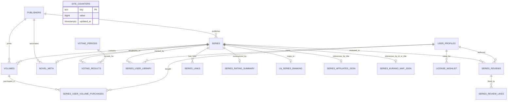

# LiDex Data Model & Entity Specifications

> **Platform**: LiDex (`wibubros.id.vn`) — Vietnamese Light Novel Discovery & Analytics Platform  
> **Database Engine**: Neon Serverless PostgreSQL (`@neondatabase/serverless`)  
> **Edge Delivery**: Cloudflare Pages & Cloudflare R2 (`pub-2080c0fa70954a7e98e48daff887c4cf.r2.dev`)  
> **Static Reference Catalogs**: `src/data/series_affiliates.json`, `src/data/series_kurano_map.json`, `src/data/license_predictions.json`

---

## 1. Overview & Data Architecture

LiDex tracks, analyzes, and presents licensed **Light Novels** in Vietnam. The architecture combines:
1. **Relational Database (Neon PostgreSQL)**: Stores canonical entities (`series`, `volumes`, `publishers`), market evaluation rankings (`ln_series_ranking`), community voting history, user collections, reviews, and global counters.
2. **Static JSON Reference Catalogs (`src/data/`)**: Bundled directly with the Next.js application for high-speed, 0ms lookup of affiliate links and external catalog mapping (Kurano Moe).
3. **Cloudflare R2 Object Storage**: Serves volume covers directly to clients via immutable CDN URLs (`covers/<uuid>.jpg`).
4. **Client-Side Cache Engine (Service Worker)**: Caches media for 7 days in the browser's CacheStorage, eliminating repeated Cloudflare worker invocations.

---

## 2. Master Entity Relationship Diagram



---

## 3. Database Table Reference

### 3.1. `publishers`
Vietnamese publishing houses and licensing imprints (e.g. IPM, Kim Đồng, Wings Books, Thái Hà Books, Nhã Nam, Tsuki Light Novel).

| Column | Type | Constraints | Description |
| :--- | :--- | :--- | :--- |
| `id` | `serial` | `PRIMARY KEY` | Auto-increment ID |
| `name` | `text` | `NOT NULL` | Short brand name (e.g. "IPM", "Kim Đồng") |
| `name_vi` | `text` | | Full formal Vietnamese business name |
| `country` | `text` | `NOT NULL DEFAULT 'VN'` | Country code (VN) |
| `website` | `text` | | Official website URL |
| `logo_url` | `text` | | Publisher logo URL |

---

### 3.2. `series`
Central hub table representing licensed Light Novel series.

| Column | Type | Constraints | Description |
| :--- | :--- | :--- | :--- |
| `id` | `serial` | `PRIMARY KEY` | Canonical integer ID (used in `/content/[id]`) |
| `item_type` | `text` | `NOT NULL CHECK ('novel')` | Content type discriminator |
| `title` | `text` | `NOT NULL` | Canonical title in Vietnamese/English |
| `title_vi` | `text` | | Vietnamese localized title |
| `title_native` | `text` | | Original Japanese title (kanji/kana) |
| `title_english` | `text` | | Official English title |
| `slug` | `text` | `UNIQUE` | URL-safe slug |
| `cover_url` | `text` | | Cloudflare R2 URL of canonical cover art |
| `banner_url` | `text` | | Wide horizontal banner image URL |
| `description` | `text` | | English synopsis |
| `description_vi`| `text` | | Vietnamese synopsis |
| `status` | `text` | `NOT NULL DEFAULT 'ongoing'` | Publication status (`ongoing`, `completed`, `hiatus`, `cancelled`, `releasing`) |
| `genres` | `text[]` | `NOT NULL DEFAULT '{}'` | PostgreSQL genre array (e.g. `{'Romance','Fantasy'}`) |
| `tags` | `text[]` | `NOT NULL DEFAULT '{}'` | Sub-tags and themes |
| `source` | `text` | | Source medium (`LIGHT_NOVEL`) |
| `author` | `text` | | Author name |
| `artist` | `text` | | Illustrator name |
| `publisher_id` | `int` | `FK → publishers(id)` | Primary Vietnamese publisher |
| `created_at` | `timestamptz` | `DEFAULT now()` | Record creation timestamp |
| `updated_at` | `timestamptz` | `DEFAULT now()` | Last modified timestamp |

---

### 3.3. `volumes`
Physical volumes published in Vietnam.

| Column | Type | Constraints | Description |
| :--- | :--- | :--- | :--- |
| `id` | `serial` | `PRIMARY KEY` | Auto-increment volume ID |
| `series_id` | `int` | `NOT NULL, FK → series(id) ON DELETE CASCADE` | Parent series reference |
| `publisher_id` | `int` | `FK → publishers(id)` | Publisher of this specific volume |
| `volume_number`| `int` | `NOT NULL` | Sequence number (1, 2, 3...). Special/side stories use `100 + sort_order`. |
| `title` | `text` | | Volume subtitle (e.g. "Tập 1", "Tập 2 - Ngoại Truyện") |
| `isbn` | `text` | | ISBN barcode |
| `cover_url` | `text` | | Cloudflare R2 cover URL (`covers/<uuid>.jpg`) |
| `release_date` | `date` | | Official Vietnam release date |
| `price` | `numeric(10,2)` | | MSRP price in Vietnamese Đồng |
| `currency` | `text` | `DEFAULT 'VND'` | Currency code |
| `is_special` | `boolean` | `DEFAULT false` | Flag for omnibus, side-story, or special edition |
| `is_digital` | `boolean` | `DEFAULT false` | Digital-only release flag |
| `translator` | `text` | | Vietnamese translator name |
| `page_count` | `int` | | Page count |
| `created_at` | `timestamptz` | `DEFAULT now()` | Record creation timestamp |

**Unique constraint**: `volumes_series_vol_uniq UNIQUE (series_id, volume_number)`.

---

### 3.4. `ln_series_ranking`
Light Novel market intelligence, algorithmic health scores, and release cadence.

| Column | Type | Constraints | Description |
| :--- | :--- | :--- | :--- |
| `id` | `bigserial` | `PRIMARY KEY` | Ranking row ID |
| `series_title` | `text` | `NOT NULL` | Light Novel title |
| `series_id` | `text` | | Legacy string identifier |
| `lidex_series_id`| `bigint` | `FK → series(id)` | **Direct foreign key to `series.id` (100% mapped, 0 NULLs)** |
| `series_code` | `text` | | Identifier slug (e.g. `'oregairu'`, `'86'`) |
| `publisher` | `text` | | Publisher name string |
| `number_of_volumes`| `numeric` | | Released volume count in Vietnam |
| `average_price` | `numeric` | | Average volume MSRP |
| `max_release_at`| `timestamp` | | Date of the latest volume release |
| `ln_score` | `numeric(4,2)` | | Algorithmic evaluation score (0.0 to 10.0 scale) |
| `evalution` | `text` | | Status verdict (`'Good'`, `'Normal'`, `'Dead'`, `'Hiatus'`) |
| `drop_percent` | `numeric` | | Drop risk probability (0.0 to 1.0) |
| `drop_basis` | `text` | | Explanation of drop risk computation |
| `evaluation_basis`| `text` | | Explanation of LN score computation |
| `average_gap_months`| `numeric` | | Average gap between volume releases |
| `months_since_last_release`| `numeric` | | Elapsed months since latest release |
| `completion_ratio`| `numeric` | | VN volumes vs JP original volumes ratio |
| `publisher_releases_last_24m`| `numeric` | | Volume velocity of publisher in last 24 months |
| `cover_url` | `text` | | Cloudflare R2 URL of latest volume cover |

---

### 3.5. `site_counters`
Global atomic counters for site-wide user actions.

| Column | Type | Constraints | Description |
| :--- | :--- | :--- | :--- |
| `key` | `text` | `PRIMARY KEY` | Metric identifier (`'what_to_read_rolls'`) |
| `value` | `bigint` | `DEFAULT 0` | Current counter value |
| `updated_at` | `timestamptz` | `DEFAULT now()` | Last increment timestamp |

---

### 3.6. User & Social Interaction Tables
* **`user_profiles`**: `user_id` (`uuid` PK), `display_name`, `avatar_url`, `is_premium`, `premium_tier`, `premium_until`.
* **`series_user_library`**: `id` (`bigint` PK), `user_id` (`uuid`), `series_id` (`bigint` FK -> `series.id`), `rating` (1–10), `status` (`'reading'`, `'completed'`, `'dropped'`, `'planned'`).
* **`series_user_volume_purchases`**: `user_id` (`uuid`), `volume_id` (`int` FK -> `volumes.id`), `created_at`.
* **`series_reviews`**: `id` (`int` PK), `series_id` (`int` FK -> `series.id`), `user_id` (`uuid`), `content`, `created_at`.
* **`series_review_likes`**: `review_id` (`int` FK -> `series_reviews.id`), `user_id` (`uuid`).
* **`license_wishlist`**: `id` (`int` PK), `user_id` (`text`), `series_title` (`text`), `created_at`.

---

## 4. Static JSON Catalogs (`src/data/`)

In addition to PostgreSQL tables, LiDex bundles three specialized JSON catalogs directly in the frontend build for instant lookup without database query overhead:

### 4.1. `series_affiliates.json` (Affiliate Links Catalog)
* **File Location**: `src/data/series_affiliates.json`
* **Source**: `Kurano_Affiliate_Parsed.xlsx` (Sheet: `Affiliate Links`).
* **Scope**: 17 active series (20 keys including title aliases like *Arya* / *Alya*, *86* / *86 Eighty Six*).
* **Criteria**: Strictly active links (`s.shopee.vn`, `vt.tiktok.com`); legacy `shope.ee` omitted; latest published volume selected; Shopee preferred.
* **Schema**:
  ```typescript
  type SeriesAffiliatesData = Record<string, {
    url: string          // e.g. "https://s.shopee.vn/6L2rR1qdPO"
    platform: string     // "Shopee" | "TikTok"
    volume: number       // e.g. 14
    volumeTitle?: string // e.g. "86-EIGHTY SIX - Ep.14"
    type: string         // "active"
  }>
  ```
* **UI Usage**:
  * `/`: Displays `[Mua ngay]` orange button on unboxing result modal.
  * `/content/[id]`: Renders `Shopee` (or `TikTok`) entry in "Liên kết ngoài" section with shopping bag icon and no `[Affiliate]` badge.

### 4.2. `series_kurano_map.json` (Kurano Moe Cross-Reference Catalog)
* **File Location**: `src/data/series_kurano_map.json`
* **Source**: `Kurano_Title_BookID.txt` (GraphQL export with 243 titles and 973 books).
* **Scope**: 238 series (97% catalog coverage).
* **Key Format**: LiDex `series.id` stringified (e.g. `"223"`, `"3"`, `"1"`).
* **Schema**:
  ```typescript
  type SeriesKuranoMap = Record<string, {
    url: string   // e.g. "https://kurano.moe/tap-truyen/5ecf395c-12b6-40fb-8f3b-d378f90ca1b1/ac-nu-nua-voi-truyen-ki-hoan-hon-doi-xac"
    slug: string  // e.g. "ac-nu-nua-voi-truyen-ki-hoan-hon-doi-xac"
    title: string // e.g. "Ác Nữ Nửa Vời - Truyền Kì Hoán Hồn Đổi Xác"
  }>
  ```
* **UI Usage**:
  * `/`: In the unbox result modal, the `[Chi tiết]` (icon `Info`) button links directly to this Kurano release URL (`target="_blank"`).
  * `/content/[id]`: Renders `Kurano (Thông tin phát hành)` in "Liên kết ngoài" with `BookOpen` pink icon.

### 4.3. `license_predictions.json` (Unlicensed Wishlist Catalog)
* **File Location**: `src/data/license_predictions.json`
* **Usage**: Houses rankings and community predictions for upcoming unlicensed Japanese Light Novels.

---

## 5. UI Integration & Gacha Mechanics

### 5.1. Unboxing Gacha Tiers & Odds (FGO Standard)
The unboxing game on `/` calculates rarity tiers via composite score:
$$\text{Composite Score} = (0.55 \times \text{LN Score}) + (0.45 \times \text{Community Vote Popularity})$$

| Tier | Name | Color | Visual Effect | Drop Odds |
| :--- | :--- | :--- | :--- | :--- |
| **4** | Báu vật (UR/SSR) | `#e4ae39` | Golden yellow animated holo line | **1.0%** (FGO SSR standard) |
| **3** | Huyền thoại (SR) | `#eb4b4b` | Red glow border | **4.0%** |
| **2** | Sơ cấp (Epic) | `#d32ce6` | Purple glow border | **15.0%** |
| **1** | Hiếm (Rare) | `#8847ff` | Blue-purple glow border | **30.0%** |
| **0** | Thông thường (Common) | `#4b69ff` | Blue standard border | **50.0%** |

### 5.2. Deterministic Roll Stat Formula
$$\text{Base Rate} = \left(\frac{\text{Tier Weight}}{\text{Titles in Tier}}\right) \times 100$$
$$\text{Variance} = 0.88 + \frac{(\text{hash}(\text{ID}) \pmod{25})}{100}$$
$$\text{Roll Percentage} = \text{Base Rate} \times \text{Variance}$$
Renders: *"Đã có X% người dùng quay ra truyện này"*.

---

## 6. What Data Currently Exists

| Entity / Source | Record Count | Description |
| :--- | :--- | :--- |
| **Novel Series (`series`)** | **247** | All licensed Vietnamese Light Novel series. |
| **Volumes (`volumes`)** | **970** | Published volumes with price, ISBN, translator, release dates. |
| **Market Rankings (`ln_series_ranking`)** | **238** | 100% foreign-key mapped to `series.id` (`lidex_series_id`). |
| **Publishers (`publishers`)** | **50+** | Vietnamese publishing companies. |
| **Active Affiliate Series (`series_affiliates.json`)** | **17** | 17 series (20 keys with aliases) on Shopee & TikTok. |
| **Kurano Mapped Series (`series_kurano_map.json`)** | **238** | 238 series (97% catalog coverage) mapped to Kurano Moe. |
| **Cover Images on Cloudflare R2** | **967** | Hosted on `pub-2080c0fa70954a7e98e48daff887c4cf.r2.dev/covers/<uuid>.jpg`. |
